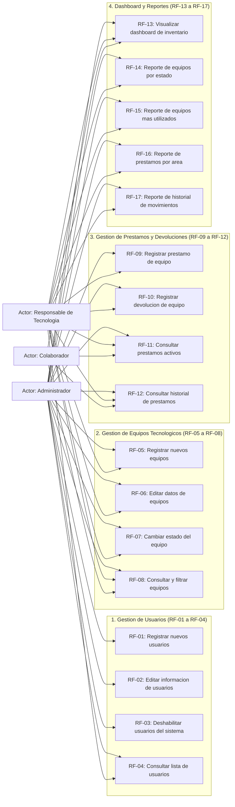
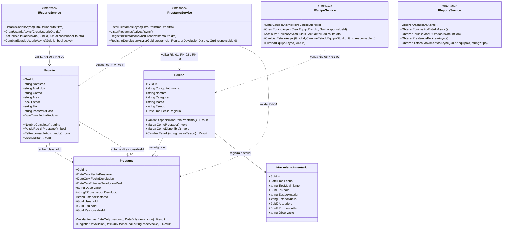
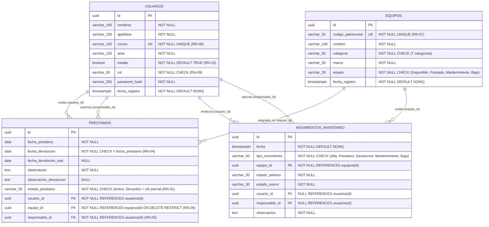
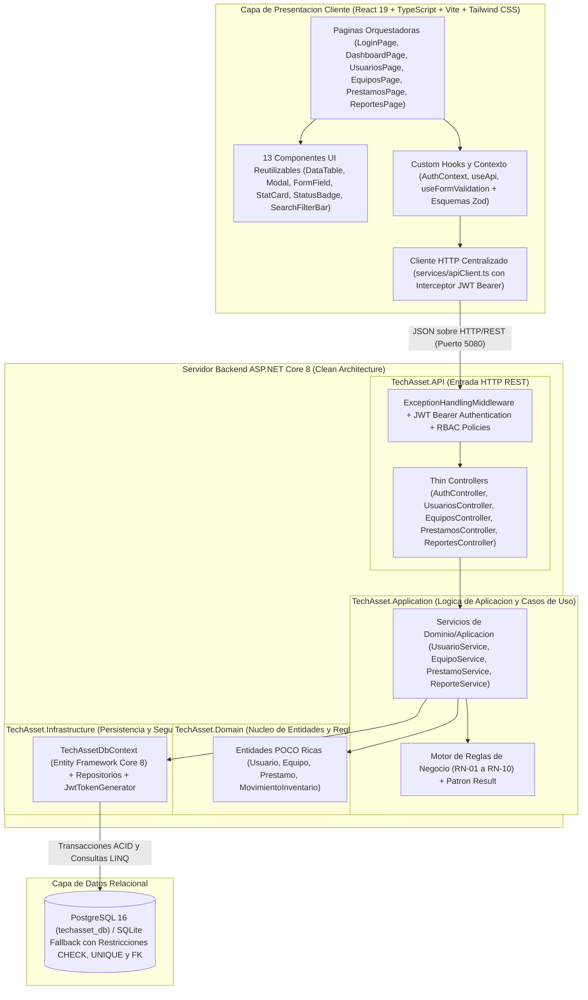

# 02. Estándares de Construcción de Software y Arquitectura del Sistema

**Sistema:** TechAsset — Sistema de Gestión de Inventario y Préstamo de Equipos Tecnológicos  
**Organización:** Innovatech Solutions S.A.C.  
**Curso / Evaluación:** Construcción de Software — Caso Práctico Integral (Criterio 1)

---

## 1. Estándares de Codificación y Nomenclatura

Con el objetivo de garantizar mantenibilidad, legibilidad y consistencia entre el Backend (`.NET 8 / C# 12`) y el Frontend (`React 19 / TypeScript 5`), el equipo de desarrollo de **TechAsset** definió y aplicó el siguiente estándar obligatorio de nomenclatura:

### 1.1 Convenciones de Nombres por Capa Tecnológica

| Elemento de Software | Convención | Ejemplo en Backend (.NET 8) | Ejemplo en Frontend (React + TS) |
| :--- | :---: | :--- | :--- |
| **Clases, Entidades, Interfaces y Componentes React** | `PascalCase` | `Equipo`, `PrestamoService`, `IEquipoRepository` | `EquiposPage.tsx`, `DataTable.tsx`, `StatusBadge.tsx` |
| **Métodos en C# y Propiedades de Entidad/DTO** | `PascalCase` | `RegistrarPrestamoAsync()`, `CodigoPatrimonial` | — |
| **Funciones, Variables Locales y Propiedades JSON/TS** | `camelCase` | `equipoExistente`, `fechaActual` | `codigoPatrimonial`, `registrarDevolucion()` |
| **Custom Hooks de React** | `camelCase` con prefijo `use` | — | `useApi.ts`, `useFormValidation.ts` |
| **Constantes Globales y Variables de Entorno** | `UPPER_SNAKE_CASE` | `ROLES_AUTORIZADOS_INVENTARIO` | `VITE_API_URL`, `CATEGORIAS_OFICIALES` |
| **Tablas, Columnas e Índices en PostgreSQL** | `snake_case` | `movimientos_inventario`, `codigo_patrimonial`, `ix_prestamos_equipo_activo` | — |
| **Rutas de Endpoints REST** | `kebab-case` (plural) | `/api/equipos`, `/api/reportes/equipos-mas-utilizados` | — |

### 1.2 Reglas de Calidad de Código
1. **Tipado estricto y nulabilidad explícita:**
   - En C# se habilita `<Nullable>enable</Nullable>` en todos los proyectos `.csproj`.
   - En TypeScript se habilita `"strict": true` prohibiendo el uso del tipo `any`.
2. **Responsabilidad única por archivo:**
   - Cada entidad de dominio, DTO, servicio, controlador o componente UI reutilizable reside en su propio archivo fuente claramente identificado.
3. **Manejo uniforme de errores:**
   - Ningún controlador expone trazas de pila (`stack traces`) crudas. Se utiliza el patrón `Result<T>` en la capa de Aplicación junto con el `ExceptionHandlingMiddleware` que devuelve respuestas JSON estandarizadas con el código de regla de negocio (`RN-01` a `RN-10`).

---

## 2. Estructura de Carpetas del Proyecto

El repositorio aplica una separación limpia entre el servidor de aplicaciones (**Clean Architecture en 4 capas** + proyecto de pruebas) y el cliente web (**Arquitectura Modular Basada en Componentes**):

```text
TechAsset/
├── backend/
│   ├── TechAsset.sln
│   ├── src/
│   │   ├── TechAsset.Domain/                 # Capa 1: Núcleo de Dominio (Sin dependencias externas)
│   │   │   ├── Entities/                     # Usuario.cs, Equipo.cs, Prestamo.cs, MovimientoInventario.cs
│   │   │   ├── Enums/                        # RolUsuario.cs, EstadoEquipo.cs, EstadoPrestamo.cs
│   │   │   └── Common/                       # Result.cs, DomainException.cs
│   │   ├── TechAsset.Application/            # Capa 2: Casos de Uso y Reglas de Negocio
│   │   │   ├── DTOs/                         # Contratos de entrada/salida (Auth, Usuarios, Equipos, Prestamos, Reportes)
│   │   │   ├── Interfaces/                   # Contratos de repositorios y servicios
│   │   │   └── Services/                     # AuthService, UsuarioService, EquipoService, PrestamoService, ReporteService
│   │   ├── TechAsset.Infrastructure/         # Capa 3: Persistencia EF Core y Seguridad JWT
│   │   │   ├── Data/                         # TechAssetDbContext.cs, DbSeeder.cs
│   │   │   ├── Repositories/                 # Implementación de repositorios EF Core
│   │   │   └── Security/                     # JwtTokenGenerator.cs, PasswordHasher.cs
│   │   └── TechAsset.API/                    # Capa 4: Presentación HTTP REST
│   │       ├── Controllers/                  # AuthController, UsuariosController, EquiposController, PrestamosController, ReportesController
│   │       ├── Middleware/                   # ExceptionHandlingMiddleware.cs
│   │       └── Program.cs
│   └── tests/
│       └── TechAsset.Tests/                  # Suite de pruebas unitarias xUnit (RN-01 a RN-10 y servicios)
├── frontend/
│   └── src/
│       ├── components/
│       │   ├── ui/                           # 13 componentes UI reutilizables (Button, DataTable, Modal, FormField, etc.)
│       │   └── layout/                       # AppLayout, Sidebar, Topbar, ProtectedRoute
│       ├── context/                          # AuthContext.tsx (Sesión JWT y RBAC)
│       ├── hooks/                            # useApi.ts, useFormValidation.ts
│       ├── pages/                            # LoginPage, DashboardPage, UsuariosPage, EquiposPage, PrestamosPage, ReportesPage
│       ├── services/                         # apiClient.ts y servicios tipados por módulo
│       ├── types/                            # Interfaces y contratos TypeScript
│       └── utils/                            # Formateadores de fechas, estados y exportación CSV
├── database/
│   └── init_techasset.sql                    # Script DDL PostgreSQL + Datos Semilla
├── postman/
│   └── TechAsset.postman_collection.json     # Colección de pruebas de API REST y Reglas RN-01..RN-10
└── docs/                                     # Documentación académica y técnica del proyecto
```

---

## 3. Estrategia de Control de Versiones (Git) y Code Review

### 3.1 Flujo de Ramas (Gitflow Simplificado)
- **`main`**: Rama estable de producción/entrega académica. Solo recibe código que compila sin advertencias y supera el 100% de pruebas unitarias.
- **`develop`**: Rama de integración continua donde convergen los incrementos de cada Sprint.
- **`feature/<modulo>-<descripcion>`**: Ramas de trabajo por requerimiento funcional (ej. `feature/rf09-registro-prestamos`, `feature/rf13-dashboard-kpis`).

### 3.2 Formato Estricto de Commits (Conventional Commits)
Todos los mensajes de confirmación siguen la especificación `<tipo>(<alcance>): <descripción en imperativo>`:
- `feat(prestamos): implementar registro de prestamos y validacion RN-01 a RN-05`
- `feat(reportes): agregar dashboard ejecutivo y 4 reportes gerenciales RF-13 a RF-17`
- `refactor(ui): extraer tabla generica DataTable y hook useFormValidation`
- `test(reglas): cubrir las 10 reglas de negocio RN-01 a RN-10 con xUnit`
- `docs(arquitectura): documentar diagramas UML, ER y estandares de construccion`

### 3.3 Checklist de Revisión de Código (Code Review — 12 Puntos de Control)

| # | Criterio de Verificación en Pull Request | Obligatorio |
| :-: | :--- | :---: |
| 1 | ¿El código respeta la convención `PascalCase` / `camelCase` / `snake_case` definida para su capa? | Sí |
| 2 | ¿El controlador de la API es delgado (*Thin Controller*) y delega toda lógica al servicio de aplicación? | Sí |
| 3 | ¿Se utilizan DTOs de entrada/salida sin exponer directamente las entidades de EF Core en las respuestas HTTP? | Sí |
| 4 | ¿Las operaciones que modifican `prestamos`, `equipos` y `movimientos_inventario` son atómicas? | Sí |
| 5 | ¿Se validan explícitamente las reglas de negocio aplicables (`RN-01` a `RN-10`) devolviendo el código HTTP correcto? | Sí |
| 6 | ¿Los endpoints protegidos cuentan con el atributo `[Authorize]` y la restricción de roles (`RN-09`)? | Sí |
| 7 | ¿El frontend reutiliza los componentes de `src/components/ui/` en lugar de duplicar HTML/Tailwind? | Sí |
| 8 | ¿Los formularios validan campos obligatorios y reglas de fecha (`RN-04`) antes de enviar la petición HTTP? | Sí |
| 9 | ¿Se manejan adecuadamente los estados de carga (`LoadingSpinner`), lista vacía (`EmptyState`) y error (`AlertBanner`)? | Sí |
| 10 | ¿El proyecto Backend compila con 0 errores (`dotnet build`) y pasan todas las pruebas (`dotnet test`)? | Sí |
| 11 | ¿El proyecto Frontend compila con 0 errores de TypeScript (`npm run build`)? | Sí |
| 12 | ¿No existen credenciales, secretos expuestos ni bloques `TODO` o código comentado muerto? | Sí |

---

## 4. Diagramas de Arquitectura y Diseño en Mermaid

### 4.1 Diagrama de Casos de Uso (3 Actores y 17 Requerimientos Funcionales)



---

### 4.2 Diagrama de Clases del Dominio y Capa de Servicios



---

### 4.3 Diagrama Entidad-Relación de Base de Datos (`erDiagram`)



---

### 4.4 Diagrama de Arquitectura en Capas (Full-Stack Clean Architecture)


