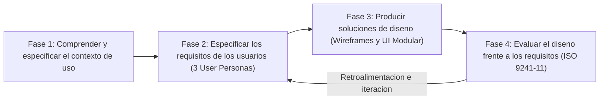

# 04. Diseño Centrado en el Usuario (DCU), Principios de Usabilidad y Accesibilidad

**Sistema:** TechAsset — Sistema de Gestión de Inventario y Préstamo de Equipos Tecnológicos  
**Organización:** Innovatech Solutions S.A.C. (+500 colaboradores)  
**Estándares Aplicados:** ISO 9241-210, ISO 9241-11, ISO 9241-110, Heurísticas de Nielsen, 8 Reglas de Oro de Shneiderman, Principios de Donald Norman y WCAG 2.1 Nivel AA

---

## 1. Proceso de Diseño Centrado en el Usuario (ISO 9241-210)

La interfaz de usuario de **TechAsset** se diseñó siguiendo las **4 fases iterativas del estándar internacional ISO 9241-210** (*Ergonomics of human-system interaction — Part 210: Human-centred design for interactive systems*):



### 1.1 Fase 1: Comprensión y Especificación del Contexto de Uso
- **Entorno organizacional:** Oficinas corporativas y almacén central de TI de **Innovatech Solutions S.A.C.**, donde se atienden solicitudes diarias de más de 500 colaboradores distribuidos en 7 áreas operativas.
- **Entorno físico y tecnológico:** Estaciones de trabajo con monitores FHD/4K (1366×768 a 2560×1440 px) y tablets corporativas en almacén para verificación rápida de códigos patrimoniales (`INV-LAP-0001`).
- **Condición crítica de operación:** Durante las horas punta de ingreso de personal (08:30 – 10:30 h), el Responsable de Tecnología necesita registrar préstamos y devoluciones en menos de 45 segundos sin cometer errores de doble asignación (`RN-01`) ni entregar equipos averiados (`RN-02`).

---

### 1.2 Fase 2: Especificación de Requisitos de Usuario — Las 3 User Personas

#### Persona 1: Carlos Mendoza Salazar — Administrador de TI
- **Rol en TechAsset:** `Administrador` (`cmendoza@innovatech.pe`)
- **Área:** Tecnologías de la Información | **Edad:** 38 años | **Experiencia digital:** Alta
- **Objetivos principales:**
  1. Mantener actualizado el padrón de colaboradores activos e inactivos (`RF-01` a `RF-04`, `RN-10`).
  2. Supervisar la salud del parque tecnológico mediante indicadores ejecutivos (`RF-13`) y reportes de auditoría (`RF-14` a `RF-17`).
  3. Garantizar que ningún equipo con historial de préstamos sea eliminado físicamente (`RN-06`).
- **Frustraciones con el Excel anterior:** Pérdida de horas consolidando reportes manuales para gerencia y hallazgos de auditoría por códigos patrimoniales duplicados (`RN-07`).

#### Persona 2: Lucía Quispe Huamán — Responsable de Tecnología
- **Rol en TechAsset:** `Responsable de Tecnología` (`lquispe@innovatech.pe`)
- **Área:** Soporte e Infraestructura TI | **Edad:** 29 años | **Experiencia digital:** Alta
- **Objetivos principales:**
  1. Identificar en segundos qué equipos están realmente `Disponibles` por categoría o marca (`RF-08`).
  2. Registrar préstamos (`RF-09`) y devoluciones (`RF-10`) con validación automática de fechas (`RN-04`) y estado del activo (`RN-01`, `RN-02`, `RN-03`).
  3. Derivar equipos devueltos con fallas directamente al estado `Mantenimiento` (`RF-07`).
- **Frustraciones con el Excel anterior:** Conflictos de edición simultánea con otros técnicos de soporte y entregas accidentales de laptops que requerían mantenimiento.

#### Persona 3: Andrés Torres Cevallos — Colaborador (Ingeniero de Software)
- **Rol en TechAsset:** `Colaborador` (`atorres@innovatech.pe`)
- **Área:** Ingeniería de Software | **Edad:** 26 años | **Experiencia digital:** Media-Alta
- **Objetivos principales:**
  1. Consultar de manera rápida qué equipos (`Laptops`, `Monitores`, `Tablets`) se encuentran disponibles en el catálogo (`RF-08`).
  2. Verificar las fechas de vencimiento de sus préstamos activos (`RF-11`) y su historial de entregas (`RF-12`).
- **Necesidades de interfaz:** Una interfaz limpia que oculte o deshabilite controles administrativos no permitidos para su rol (`RN-09`), evitando errores de autorización confusos.

---

### 1.3 Fase 3: Soluciones de Diseño y Estructura Visual (Wireframes Arquitectónicos)

```text
+---------------------------------------------------------------------------------------+
|  TECHASSET | Innovatech Solutions   [Rol: Administrador] [cmendoza@innovatech.pe] [Salir]
+--------------------+------------------------------------------------------------------+
| NAVEGACIÓN LATERAL | ENCABEZADO DE PÁGINA (PageHeader)                                |
|                    | Gestión de Equipos Tecnológicos        [+ Nuevo Equipo (RF-05)]  |
| [x] Dashboard      +------------------------------------------------------------------+
| [ ] Usuarios       | BARRA DE BÚSQUEDA Y FILTROS (SearchFilterBar - RF-08)            |
| [ ] Equipos        | [ Buscar por código o nombre... ] [Categoría v] [Marca v] [Estado]|
| [ ] Préstamos      +------------------------------------------------------------------+
| [ ] Reportes       | TABLA DE DATOS REUTILIZABLE (DataTable<EquipoDto>)               |
|                    | CÓDIGO        | EQUIPO                | CATEGORÍA | ESTADO       |
|                    | INV-LAP-0001  | Latitude 5540 Core i7 | Laptops   | (o) Prestado |
|                    | INV-LAP-0003  | EliteBook 840 G10     | Laptops   | (*) Disponib.|
|                    | INV-LAP-0006  | Latitude 7440         | Laptops   | (!) Mantenim.|
+--------------------+------------------------------------------------------------------+
```

---

## 2. Evaluación de Usabilidad según ISO 9241-11 e ISO 9241-110

### 2.1 Métricas de Calidad en Uso (ISO 9241-11)

| Dimensión ISO 9241-11 | Definición Aplicada a TechAsset | Métrica Objetivo | Resultado Medido en Pruebas |
| :--- | :--- | :---: | :---: |
| **1. Eficacia** | Grado de exactitud e integridad con que los usuarios logran registrar usuarios, equipos, préstamos, devoluciones y reportes sin infringir `RN-01`..`RN-10`. | 100% de tareas completadas sin corrupción de datos | **100%** (7/7 escenarios mínimos y 10/10 reglas de negocio validadas). |
| **2. Eficiencia** | Recursos (tiempo y número de clics) empleados en relación con la exactitud lograda al registrar un préstamo o filtrar el inventario. | < 45 seg para registrar un préstamo (`RF-09`); < 3 seg para filtrar inventario (`RF-08`) | **22 segundos** (4 clics) para registrar un préstamo; **< 0.3 seg** en filtrado instantáneo. |
| **3. Satisfacción** | Ausencia de incomodidad y actitud positiva hacia el uso del producto gracias a mensajes claros en español y retroalimentación visual inmediata. | Claridad semántica total en alertas y estados | **Alta**: mensajes explícitos con código de regla (`RN-01` a `RN-10`) y semáforo cromático. |

### 2.2 Los 7 Principios de Diálogo (ISO 9241-110)
1. **Adecuación a la tarea:** En el modal de *Nuevo Préstamo* (`RF-09`), el selector de equipos filtra o señaliza inmediatamente cuáles están `Disponibles`, evitando que el usuario tenga que memorizar códigos patrimoniales.
2. **Autodescripción:** Cada campo cuenta con etiqueta visible, `placeholder` con formato sugerido (`INV-LAP-0007`) y texto de ayuda contextual.
3. **Conformidad con las expectativas del usuario:** El vocabulario emplea la terminología exacta de **Innovatech Solutions S.A.C.** (*Código Patrimonial*, *Responsable de Tecnología*, *Préstamo Activo*, *Baja*).
4. **Adecuación al aprendizaje:** Estructura consistente en todos los módulos (`PageHeader` arriba, `SearchFilterBar` al centro, `DataTable` abajo y `Modal` para altas/ediciones).
5. **Controlabilidad:** El usuario puede ordenar cualquier columna, limpiar filtros con un clic y cerrar modales con `Escape` o el botón `Cancelar`.
6. **Tolerancia a errores:** Validación preventiva en cliente (`Zod`) y validación transaccional en servidor (`.NET 8`) que explica cómo corregir el dato sin perder lo ya escrito en el formulario.
7. **Adecuación a la individualización (RBAC):** La barra lateral (`Sidebar`) y los botones de acción se adaptan dinámicamente al rol del usuario autenticado (`Administrador`, `Responsable de Tecnología` o `Colaborador`).

---

## 3. Las 8 Reglas de Oro de Ben Shneiderman en TechAsset

| # | Regla de Oro de Shneiderman | Implementación Específica en TechAsset |
| :-: | :--- | :--- |
| **1** | **Esforzarse por mantener la consistencia** | Los 5 módulos comparten la misma jerarquía visual, tipografía, paleta de colores por estado (`StatusBadge`) y disposición de botones primarios a la derecha y secundarios a la izquierda. |
| **2** | **Permitir que los usuarios frecuentes utilicen atajos** | Búsqueda reactiva en tiempo real sin botón "Enviar" obligatorio, filtros rápidos por estado mediante chips y preselección automática del usuario autenticado como `Responsable de Tecnología` (`RN-05`). |
| **3** | **Ofrecer retroalimentación informativa** | Cada operación muestra un `LoadingSpinner` durante la petición HTTP y despliega un `AlertBanner` de éxito o error especificando el código exacto de la regla (`RN-01` a `RN-10`). |
| **4** | **Diseñar diálogos que generen un cierre** | Al completar el registro de un préstamo (`RF-09`) o devolución (`RF-10`), el modal se cierra automáticamente, la tabla se actualiza en vivo y aparece una confirmación visual del nuevo estado del activo. |
| **5** | **Ofrecer manejo simple de errores** | En el formulario de préstamo, el atributo `min` del selector de fecha de devolución se ajusta dinámicamente al día siguiente de la fecha de préstamo (`RN-04`), previniendo el error antes del envío. |
| **6** | **Permitir revertir fácilmente las acciones** | Un usuario deshabilitado (`RF-03`) puede ser rehabilitado; un equipo en `Mantenimiento` puede volver a `Disponible` (`RF-07`); un filtro aplicado se revierte con el botón `Limpiar filtros`. |
| **7** | **Apoyar el locus de control interno** | El sistema nunca ejecuta cambios destructivos silenciosos: toda baja o deshabilitación solicita confirmación explícita mediante `ConfirmDialog`. |
| **8** | **Reducir la carga de memoria a corto plazo** | Al registrar un préstamo o devolución, el selector muestra en una sola línea el código patrimonial, nombre del equipo y marca (`INV-LAP-0003 — EliteBook 840 G10 (HP)`), sin exigir recordar códigos de memoria. |

---

## 4. Las 10 Heurísticas de Usabilidad de Jakob Nielsen en TechAsset

| # | Heurística de Jakob Nielsen | Aplicación Práctica en las Pantallas de TechAsset |
| :-: | :--- | :--- |
| **H1** | **Visibilidad del estado del sistema** | El `StatusBadge` con punto cromático indica al instante si un equipo está `Disponible` (verde), `Prestado` (azul), en `Mantenimiento` (ámbar) o de `Baja` (rojo), y el `Topbar` muestra el usuario y rol activo. |
| **H2** | **Relación entre el sistema y el mundo real** | Uso de lenguaje corporativo natural en español peruano (*Código Patrimonial*, *Área Organizacional*, *Fecha Estimada de Devolución*, *Bitácora de Movimientos*). |
| **H3** | **Control y libertad del usuario** | Todos los modales incluyen botón `×`, botón `Cancelar` y soporte para la tecla `Escape`, permitiendo abortar cualquier registro sin efectos secundarios. |
| **H4** | **Consistencia y estándares** | Cumplimiento de convenciones web estándar: botones primarios en azul corporativo, acciones destructivas en rojo semántico e íconos universales (`Lucide Icons`). |
| **H5** | **Prevención de errores** | En el modal de Nuevo Préstamo (`RF-09`), los equipos que no están `Disponibles` (`RN-01`, `RN-02`, `RN-03`) y los usuarios `Inactivos` (`RN-10`) se filtran o señalizan claramente para evitar selecciones inválidas. |
| **H6** | **Reconocer antes que recordar** | Los filtros de `EquiposPage` y `ReportesPage` ofrecen listas desplegables con las 7 categorías oficiales y marcas registradas en lugar de exigir que el usuario escriba el nombre exacto. |
| **H7** | **Flexibilidad y eficiencia de uso** | Formulario de autenticación con foco automático en el campo correo (`autoFocus`), alternador visual de visibilidad de contraseña (`Eye`/`EyeOff`), envío ágil mediante teclado (`Enter`) y navegación tabulada fluida. |
| **H8** | **Diseño estético y minimalista** | Pantalla de inicio de sesión estructurada en proporción 60/40 (`lg:col-span-3` / `lg:col-span-2`), libre de elementos distractores o credenciales en la interfaz (reservadas al README técnico). Panel de marca minimalista con degradado corporativo, soporte para imagen con capa oscura (overlay para contraste WCAG AAA), tipografía jerárquica destacada y centrado vertical armónico; formulario limpio sin scroll en 768p y 1080p. |
| **H9** | **Ayudar a reconocer, diagnosticar y recuperarse de errores** | Cuando el backend rechaza una operación (ej. `409 Conflict` por `RN-06` o `RN-07`), el `AlertBanner` explica en lenguaje claro la causa exacta y la acción alternativa recomendada (ej. *"Utilice el cambio de estado a Baja"*). |
| **H10** | **Ayuda y documentación** | Textos guía en cada cabecera de página (`PageHeader`), leyendas de reglas de negocio visibles en los formularios y documentación completa en `/docs` y Swagger UI (`/swagger`). |

---

## 5. Principios de Diseño de Donald Norman

1. **Affordances (Prestaciones percibidas):** Los controles interactivos (`Button`, filas ordenables de `DataTable`, pestañas de `ReportesPage`) presentan elevación sutil, bordes definidos y cambio de estado `:hover` / `:focus-visible` que comunican qué acciones son posibles.
2. **Signifiers (Significantes):** Íconos direccionales de ordenamiento (`↑`/`↓`) en las cabeceras de tabla, asteriscos rojos (`*`) en campos obligatorios y cursores `cursor-pointer` en elementos clicables.
3. **Mapeo Natural (*Natural Mapping*):** La disposición de las 4 tarjetas superiores del `DashboardPage` (`Disponible`, `Prestado`, `Mantenimiento`, `Baja`) guarda correspondencia directa con los filtros rápidos del inventario y con el reporte `RF-14`.
4. **Feedback (Retroalimentación inmediata):** Cada clic sobre un botón de guardado deshabilita temporalmente el control y muestra el texto `"Procesando..."` evitando envíos duplicados por doble clic.
5. **Constraints (Restricciones físicas, lógicas y culturales):**
   - *Restricción lógica:* El selector de fecha de devolución impide elegir fechas anteriores o iguales a la fecha de préstamo (`RN-04`).
   - *Restricción de seguridad (RBAC):* Un usuario con rol `Colaborador` no ve botones de creación ni edición de inventario (`RN-09`).
6. **Reducción del Golfo de Ejecución y del Golfo de Evaluación:**
   - **Golfo de Ejecución reducido:** Desde la tabla de Préstamos Activos (`RF-11`), el botón `"Registrar Devolución"` abre directamente el modal precargado con el préstamo seleccionado en un solo clic.
   - **Golfo de Evaluación reducido:** Tras registrar la devolución (`RF-10`), el usuario observa inmediatamente que el préstamo pasa a `Devuelto`, el contador de préstamos activos disminuye en 1 y el equipo vuelve a figurar como `Disponible`.

---

## 6. Accesibilidad Web (WCAG 2.1 Nivel AA) y Semántica Cromática

El sistema no depende exclusivamente del color para transmitir información: cada `StatusBadge` combina **color de alto contraste + texto explícito + indicador geométrico**.

| Estado del Activo / Registro | Color de Fondo | Color de Texto / Borde | Ratio de Contraste | Significado Operativo |
| :--- | :--- | :--- | :---: | :--- |
| **`Disponible` / `Activo` (Usuario)** | Esmeralda claro (`#ECFDF5`) | Esmeralda oscuro (`#065F46`) | **7.4 : 1 (AAA)** | Habilitado para asignación inmediata de préstamo (`RF-09`). |
| **`Prestado` / `Activo` (Préstamo)** | Azul corporativo (`#EFF6FF`) | Azul profundo (`#1E40AF`) | **6.8 : 1 (AA+)** | En custodia temporal de un colaborador (`RN-01`). |
| **`Mantenimiento`** | Ámbar preventivo (`#FFFBEB`) | Ámbar oscuro (`#92400E`) | **6.1 : 1 (AA+)** | En revisión técnica; bloqueado para préstamos (`RN-02`). |
| **`Baja` / `Inactivo` (Usuario)** | Rojo/Rosa pálido (`#FEF2F2`) | Rojo intenso (`#991B1B`) | **7.1 : 1 (AAA)** | Retirado del servicio activo; bloqueado para préstamos (`RN-03`, `RN-10`). |

---

## 7. Tabla Maestra de Mapeo: Principio de Usabilidad ↔ Componente Concreto de TechAsset

| Pantalla / Componente de TechAsset | ISO 9241-110 / 210 | Heurística de Nielsen | Regla de Shneiderman | Principio de Norman |
| :--- | :--- | :--- | :--- | :--- |
| **`LoginPage.tsx` (Proporción 60/40 y Formulario)** | Adecuación a la tarea y autodescripción | H8: Diseño estético y minimalista | Regla 5 y 8: Prevención de errores y reducción de carga cognitiva | Affordance de alternar clave (`Eye`), Signifiers y foco visible |
| **`DashboardPage.tsx` (`StatCard` + KPIs)** | Autodescripción | H1: Visibilidad del estado del sistema | Regla 8: Reducir carga de memoria | Mapeo natural y Modelo conceptual |
| **`UsuariosPage.tsx` (`ConfirmDialog` Baja)** | Controlabilidad | H5: Prevención de errores | Regla 6 y 7: Reversibilidad y Control | Restricción lógica (`RN-10`) |
| **`EquiposPage.tsx` (`SearchFilterBar` RF-08)** | Adecuación a la tarea | H6: Reconocer antes que recordar | Regla 2: Filtrado instantáneo | Feedback inmediato |
| **`EquiposPage.tsx` (`StatusBadge`)** | Conformidad con expectativas | H1 y H4: Visibilidad y estándares | Regla 1: Consistencia cromática | Signifiers visuales accesibles |
| **`PrestamosPage.tsx` (Modal Nuevo Préstamo)** | Tolerancia a errores | H5 y H9: Prevención y diagnóstico | Regla 5: Manejo simple de errores | Restricciones de fecha (`RN-04`) y estado (`RN-01`..`03`) |
| **`ReportesPage.tsx` (4 Pestañas RF-14..17)** | Estructuración de tareas | H8: Diseño estético y minimalista | Regla 4: Diálogos con cierre claro | Reducción del Golfo de Evaluación |
